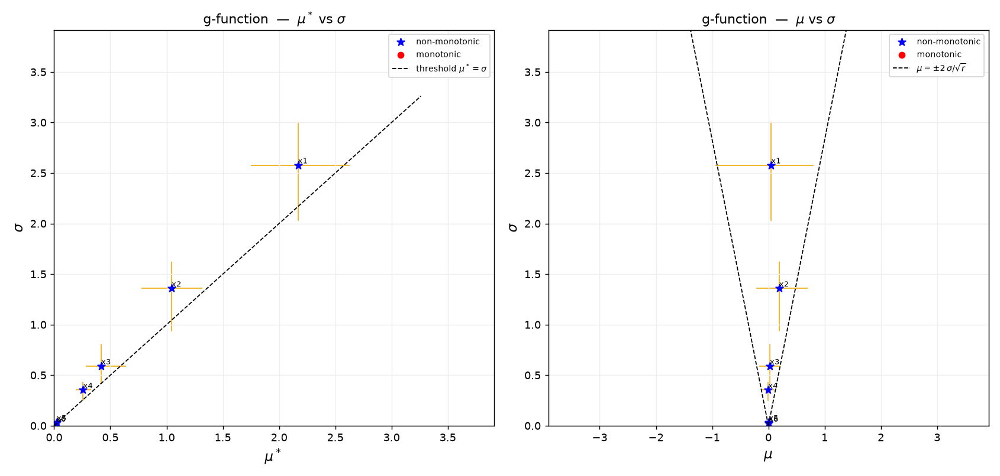

# eSU-py

**Elementary Effects global sensitivity analysis with Enhanced Sampling for Uniformity (eSU), in Python.**

eSU-py finds which inputs (factors) of a model control its outputs. It uses the
Elementary Effects (EE) screening method of Morris (1991) with the eSU sampling
strategy (Khare et al., 2015; Chitale et al., 2017). It is a Python port of the
Morris SU MATLAB package (Khare and Muñoz-Carpena, 2022).

The program:

1. makes the eSU sample of factor values for your model runs,
2. calculates the sensitivity measures μ\*, μ and σ from your model outputs,
3. draws the μ\*–σ and μ–σ screening plots.

Your model can be a Python function or any external program (Fortran, R, Excel, a GUI model).

📖 **User guide:** [docs/eSU_Python_Guide.md](docs/eSU_Python_Guide.md) ·
[PDF](docs/eSU_Python_Guide.pdf)



## Install

You need Python 3 (3.10 or newer), numpy and matplotlib.

```bash
git clone https://github.com/carpena1/eSU-py.git
cd eSU-py
python3 -m venv venv
source venv/bin/activate          # Windows: venv\Scripts\activate
pip install -r requirements.txt
```

No git? Use **Code → Download ZIP** on the GitHub page and unzip it.

## Quick start

**A. Your model is a Python function** — see [examples/example_gfunction.py](examples/example_gfunction.py):

```python
import numpy as np
import esu

unit = esu.esu_sample(d, r, p, np.random.default_rng(1))   # eSU sample in [0, 1]
real = esu.map_uniform(unit, lo, hi)                        # real factor values
Y = np.array([model(row) for row in real])                  # run your model
EE = esu.elementary_effects(unit, Y, p)
mu_star, mu, sigma = esu.ee_measures(EE)
esu.ee_plot(mu_star, mu, sigma, EE, names, "My model", "my_model_EE.png")
```

```bash
cd examples
python example_gfunction.py
```

**B. Your model is an external program** — use [esu_files.py](esu_files.py) with CSV files:

```bash
cd examples
python ../esu_files.py sample factors.csv --p 8 --r 16 --seed 1   # -> esu_sample.csv
python demo_external_model.py                                    # your model -> esu_outputs.csv
python ../esu_files.py analyze                                   # -> EE_Measures.txt, EE_<output>.png
```

`factors.csv` has one row per factor: `name,lo,hi`. Replace `demo_external_model.py`
with your own model runs: one output row for each row of `esu_sample.csv`, in the
same order.

## Repository contents

| Path | Contents |
|------|----------|
| `esu.py` | The program: eSU sampler, EE measures, screening plots |
| `esu_files.py` | Command-line driver for external models (CSV in, CSV/TXT/PNG out) |
| `examples/` | Example A (`example_gfunction.py`), Example B (`factors.csv`, `demo_external_model.py`) |
| `docs/` | User guide (Markdown + PDF), figures, `build_pdf.sh` to rebuild the PDF |
| `tests/` | `test_esu.py` (structural tests), `validate_esu.py` (vs MATLAB), `validate_salib.py` (vs SALib) |

## Tests

```bash
python tests/test_esu.py
```

All five tests must show `PASS`. The two validation scripts need the packages in
`requirements-dev.txt`; `validate_esu.py` also needs the MATLAB example files
(set `ESU_MATLAB_DIR`).

## How to cite

Please cite the method papers (also in [CITATION.cff](CITATION.cff)):

- Khare, Y.P., Muñoz-Carpena, R., Rooney, R.W., & Martinez, C.J. (2015). A multi-criteria trajectory-based parameter sampling strategy for the screening method of elementary effects. *Environmental Modelling & Software* 64, 230–239. doi: [10.1016/j.envsoft.2014.11.013](https://doi.org/10.1016/j.envsoft.2014.11.013)
- Chitale, J., Khare, Y.P., Muñoz-Carpena, R., Dulikravich, G.S., & Martinez, C.J. (2017). An effective parameter screening strategy for high dimensional models. *ASME IMECE 2017*, Volume 7: Fluids Engineering, V007T09A017. doi: [10.1115/IMECE2017-71458](https://doi.org/10.1115/IMECE2017-71458)
- Khare, Y.P., & Muñoz-Carpena, R. (2022). *Morris SU (Sampling Uniformity) Matlab code*. University of Florida. <https://abe.ufl.edu/carpena/software/morris-su-sampling/>

The full reference list is in the user guide.

## License

[MIT](LICENSE)
