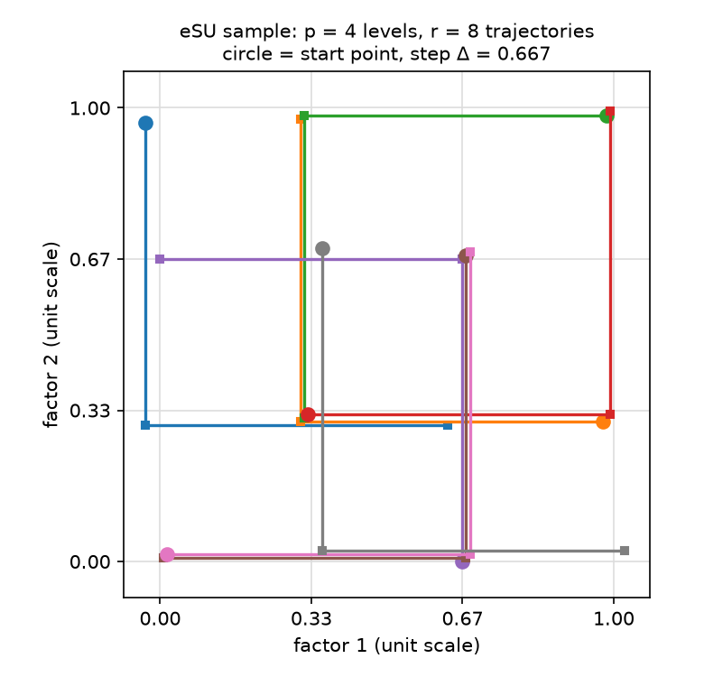
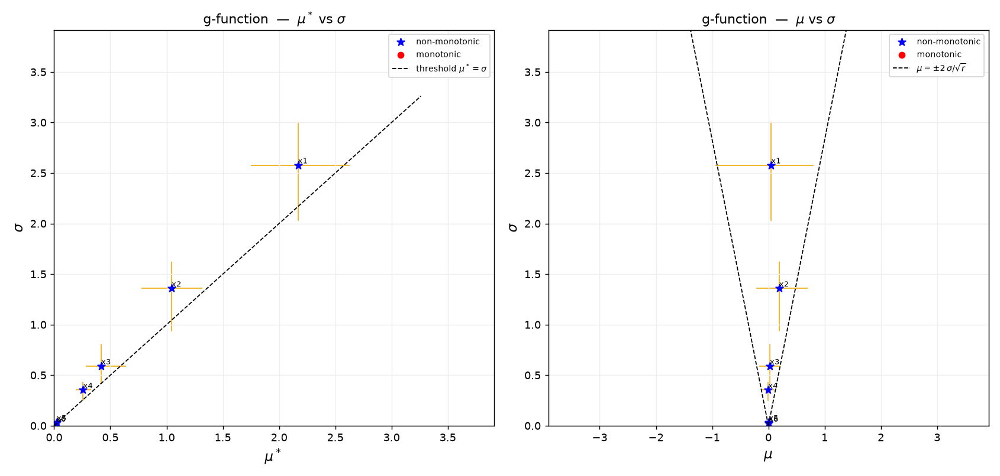

# 1. What the program does

`esu.py` is a small Python program for **global sensitivity analysis** (GSA) with
the **Elementary Effects (EE)** method of Morris (1991). It uses the **eSU**
sampling strategy (Enhanced Sampling for Uniformity) of Khare et al. (2015) and
Chitale et al. (2017). It is a Python port of the group's eSU MATLAB package
(Khare and Muñoz-Carpena, 2022).

Global sensitivity analysis tells you which model inputs control a model output
when all inputs change together over their full ranges. We call each uncertain
input a **factor** (a parameter, a boundary condition, an input value). The EE
method is a **screening** method. It needs few model runs. It sorts factors into
three groups:

- factors with a negligible effect (you can fix them at a nominal value),
- factors with an important, mostly linear and additive effect,
- factors with an important non-linear effect or with interactions with other factors.

The program does four things:

1. It makes the eSU sample: a set of factor values for your model runs.
2. It maps the sample from the unit scale [0, 1] to the real factor ranges.
3. It calculates the elementary effects and the sensitivity measures $\mu^*$,
   $\mu$ and $\sigma$ from your model outputs.
4. It draws the two screening plots ($\mu^*$–$\sigma$ and $\mu$–$\sigma$).

You run your model yourself between steps 2 and 3. The model can be a Python
function or any external program (Fortran, R, Excel, a GUI model).

# 2. Files and installation

## 2.1 Files

The program is on GitHub: <https://github.com/carpena1/eSU-py>. The program
itself is one file, `esu.py`. The other files are examples, tests and this guide.

| File | What it is |
|------|-----------|
| `esu.py` | The program (a Python module). All the functions are in this file. |
| `esu_files.py` | A ready-to-use script for models outside Python. It reads and writes CSV files (Section 5). |
| `examples/example_gfunction.py` | Example A: a complete analysis of a model written in Python (Section 4). |
| `examples/factors.csv` | Example B: an example factor table for `esu_files.py`. |
| `examples/demo_external_model.py` | Example B: a stand-in for an external model. |
| `docs/eSU_Python_Guide.md`, `.pdf` | This guide. `docs/build_pdf.sh` rebuilds the PDF. |
| `tests/test_esu.py` | Tests of the sampler and of the EE calculation (Section 11). |
| `tests/validate_esu.py`, `tests/validate_salib.py` | Comparisons with the MATLAB package and with SALib. |
| `requirements.txt` | The Python packages you need. |
| `LICENSE`, `CITATION.cff` | MIT license; how to cite. |

## 2.2 Installation

You need Python 3 (3.10 or newer is a safe choice), **numpy** (1.24 or newer) and
**matplotlib** (3.6 or newer).

1. Install Python 3 from <https://www.python.org> (or use Anaconda).
2. Get the program. With git:

   ```bash
   git clone https://github.com/carpena1/eSU-py.git
   ```

   Without git: open <https://github.com/carpena1/eSU-py>, click
   **Code → Download ZIP**, and unzip the file.
3. Open a terminal in the `eSU-py/` folder.
4. Make a virtual environment (a private Python installation for this folder):

   ```bash
   python3 -m venv venv
   ```

5. Activate it. On macOS and Linux:

   ```bash
   source venv/bin/activate
   ```

   On Windows: `venv\Scripts\activate`.

6. Install the two packages:

   ```bash
   pip install -r requirements.txt
   ```

7. Run the example to check the installation:

   ```bash
   cd examples
   python example_gfunction.py
   ```

For your own work, you can also copy `esu.py` (and `esu_files.py`) into your
project folder. The example scripts find `esu.py` in the same folder or in the
folder one level up.

> **Note.** `import esu` sets the matplotlib "Agg" backend. The plots go to PNG
> files. `plt.show()` does not open a window after you import `esu`.

# 3. The method in short

## 3.1 Factors, levels and the unit scale

You give each factor $i$ a range $[lo_i, hi_i]$ with a **uniform** distribution.
The program works on the **unit scale**: it maps each range to [0, 1]. On this
scale each factor can take $p$ equally spaced **levels**:

$$ x \in \left\{0, \tfrac{1}{p-1}, \tfrac{2}{p-1}, \ldots, 1\right\} $$

$p$ must be even (the usual values are 4, 6, 8, …, 16).

## 3.2 Trajectories

The EE method uses **trajectories** (Morris, 1991). A trajectory starts at a
random point on the grid. Then it changes **one factor at a time**, in a random
order, by a fixed step $\Delta$:

$$ \Delta = \frac{p}{2(p-1)} $$

If the factor value is below 0.5, the step is $+\Delta$. Otherwise it is
$-\Delta$. This keeps all points on the grid. Each factor moves exactly once, so
one trajectory has $d+1$ points for $d$ factors. A sample of $r$ trajectories
needs

$$ N = r\,(d+1) \text{ model runs.} $$

| $p$ | 4 | 6 | 8 | 10 | 12 | 16 |
|---|---|---|---|---|---|---|
| $\Delta$ (unit scale) | 0.667 | 0.600 | 0.571 | 0.556 | 0.545 | 0.533 |

On the real scale the step is $\Delta\,(hi_i - lo_i)$.

{width=45%}

## 3.3 What eSU adds: uniform start points

Classical Morris sampling picks the start points at random. With few
trajectories, some levels can then be sampled many times and others not at all.
**eSU** fixes this. For each factor, each of the $p$ levels is a start value
exactly $r/p$ times, in random order (Khare et al., 2015; Chitale et al., 2017).
So the sample covers each factor range uniformly, also with a small $r$. This is
why **$r$ must be a multiple of $p$** (and even).

## 3.4 Elementary effects and the sensitivity measures

In each trajectory, factor $i$ moves once, from point $\mathbf{x}$ to point
$\mathbf{x}'$. Its **elementary effect** is the change in the output divided by
the step (both on the unit scale):

$$ EE_i = \frac{Y(\mathbf{x}') - Y(\mathbf{x})}{x'_i - x_i} = \pm\frac{Y(\mathbf{x}') - Y(\mathbf{x})}{\Delta} $$

Because the step is on the unit scale, $EE_i$ has the **units of the output**. It is
about the change in $Y$ over the full range of factor $i$. So you can compare
the EEs of factors with different units.

With $r$ trajectories, each factor has $r$ elementary effects. The program
calculates three measures for each factor:

| Measure | Formula | Meaning |
|---|---|---|
| $\mu^*$ | $\frac{1}{r}\sum_k \lvert EE_i^{(k)}\rvert$ | Overall importance (Campolongo et al., 2007). Large $\mu^*$: important factor. |
| $\mu$ | $\frac{1}{r}\sum_k EE_i^{(k)}$ | Mean effect, with its sign. Positive: $Y$ increases when the factor increases. Effects of opposite sign cancel. |
| $\sigma$ | $\sqrt{\frac{1}{r-1}\sum_k \left(EE_i^{(k)}-\mu\right)^2}$ | Spread of the effects. Large $\sigma$: the effect changes with the factor value (non-linear) or with the values of other factors (interaction). |

The EE method cannot separate non-linearity from interactions. A large $\sigma$
means "non-linear **or** interacting **or** both".

# 4. Example A: a model written in Python

Use this path when you can call your model as a Python function. The file
`examples/example_gfunction.py` has the complete script. It uses the **Sobol g-function**,
a standard test model with a known answer:

$$ Y = \prod_{i=1}^{6}\frac{\lvert 4x_i-2\rvert + a_i}{1+a_i}, \quad x_i \in [0,1],\quad a = (0,\,1,\,4.5,\,9,\,99,\,99) $$

A small $a_i$ makes factor $i$ important. So the true order is
x1 > x2 > x3 > x4, and x5, x6 are negligible.

The script has six steps:

```python
import numpy as np
import esu

# 1. Factors and their ranges (uniform distributions)
names = ["x1", "x2", "x3", "x4", "x5", "x6"]
lo = [0.0] * 6
hi = [1.0] * 6
d = len(names)
a = np.array([0.0, 1.0, 4.5, 9.0, 99.0, 99.0])

# 2. The model: one output value for one row of factor values
def model(x):
    return np.prod((np.abs(4 * x - 2) + a) / (1 + a))

# 3. Sampling design
p, r = 8, 32                                   # levels, trajectories
rng = np.random.default_rng(12345)             # seed -> repeatable sample
unit = esu.esu_sample(d, r, p, rng)            # r*(d+1) rows x d columns, in [0, 1]
real = esu.map_uniform(unit, lo, hi)           # real factor values

# 4. Run the model for every row
Y = np.array([model(row) for row in real])

# 5. Elementary effects and the sensitivity measures
EE = esu.elementary_effects(unit, Y, p)        # d x r
mu_star, mu, sigma = esu.ee_measures(EE)
print(esu.format_measures(names, mu_star, mu, sigma))

# 6. Screening plot
esu.ee_plot(mu_star, mu, sigma, EE, names, "g-function", "gfunction_EE.png",
            rng=np.random.default_rng(0))
```

To use it for your own model:

1. Change `names`, `lo` and `hi` (step 1).
2. Replace `model(x)` with a call to your model (step 2). `x` is one row of
   real factor values, in the order of `names`. The function must return one
   number.
3. Set `p` and `r` (step 3; see Section 6).

The program writes this table (`gfunction_EE_Measures.txt`):

```text
facname          mu*           mu        sigma  Monotonic  Interactions
x1        2.1682e+00   4.9419e-02   2.5781e+00      N           Y
x2        1.0449e+00   1.9141e-01   1.3586e+00      N           Y
x3        4.1894e-01   2.5309e-02   5.8991e-01      N           Y
x4        2.5800e-01  -4.6759e-03   3.5399e-01      N           Y
x5        2.3341e-02   4.9665e-03   3.3560e-02      N           Y
x6        1.8526e-02   4.0030e-03   2.3262e-02      N           Y
```

Section 7 explains how to read the table and the plot.

# 5. Example B: a model outside Python (CSV files)

Use `esu_files.py` when your model is a separate program. You do not need to
write Python. The data goes through CSV files (comma-separated text files that
Excel can open and save).

## 5.1 Step 1: describe the factors

Make a file `factors.csv` with a header row and one row per factor. The columns
are `name`, `lo` and `hi`:

```text
name,lo,hi
Ks,1,50
porosity,0.30,0.50
CN,60,90
slope,0.01,0.10
dummy,0,1
```

> **Tip.** Add a **dummy** factor that your model does not use. Its $\mu^*$ must
> be zero (or close to zero). Factors with a $\mu^*$ near the dummy value are
> negligible.

## 5.2 Step 2: make the sample

```bash
python esu_files.py sample factors.csv --p 8 --r 16 --seed 1
```

The program writes two files:

- `esu_sample.csv`: the factor values in real units. It has one row per model
  run ($N = r(d+1)$ rows) and one column per factor.
- `esu_design.json`: $p$, $r$, the factor names and the ranges. Step 4 reads
  this file. Do not change it.

| Option | Default | Meaning |
|---|---|---|
| `--p` | 8 | Number of levels. Must be even. |
| `--r` | 16 | Number of trajectories. Must be a multiple of `p`. |
| `--seed` | none | Random seed. The same seed gives the same sample. Without a seed, each call gives a new sample. |
| `--out` | `esu_sample.csv` | Name of the sample file. |
| `--design` | `esu_design.json` | Name of the design file. |

## 5.3 Step 3: run your model

1. Run your model once for each row of `esu_sample.csv`.
2. Keep the **same row order**. Do not sort or delete rows.
3. Save the results in `esu_outputs.csv`: a header row with the output names,
   then one row per model run and one column per output. For example:

```text
runoff,peak
12.81,3.204
13.07,3.268
...
```

If a run fails, leave the cell empty or write `nan` or `NA`. The program then
ignores the elementary effects that use this run (see Section 8.4).

> **Try it.** The `examples/` folder has a complete Example B. The script
> `demo_external_model.py` acts as the external model. From `examples/`:
>
> ```bash
> python ../esu_files.py sample factors.csv --p 8 --r 16 --seed 1
> python demo_external_model.py
> python ../esu_files.py analyze
> ```
>
> The model does not use `porosity` and `dummy`, so their $\mu^*$ is zero.

## 5.4 Step 4: analyze

```bash
python esu_files.py analyze
```

The program prints the measures (sorted by $\mu^*$) and writes, for each output
column:

| File | Contents |
|---|---|
| `EE_Measures.txt` | The measures table for all outputs (same layout as the MATLAB `*_EE_Measures.txt`). |
| `EE_raw_<output>.csv` | All elementary effects: one row per factor, one column per trajectory. |
| `EE_<output>.png` | The two screening plots. |

Options: `--outputs` (default `esu_outputs.csv`), `--sample` (default: the file
named in the design file), `--design` and `--report` (default `EE_Measures.txt`).

# 6. Choosing p and r

The cost of the analysis is $N = r\,(d+1)$ model runs. So $r$ sets the cost.

| Choice | Rule | Common start value |
|---|---|---|
| $p$ (levels) | Even number, 4 to 16 | 8 |
| $r$ (trajectories) | Even and a multiple of $p$ | 16 to 32 (more for many factors or a noisy model) |

Example: 20 factors, $p = 8$, $r = 16$ gives $16 \times 21 = 336$ runs.

**Check the result.** The eSU sample is random. Do this check before you trust
a factor ranking:

1. Repeat the analysis with two or three different seeds.
2. Compare the order of the important factors and the confidence intervals in
   the plots.
3. If the order of the important factors changes, increase $r$ (for example from
   16 to 32) and repeat.

The negligible factors often change order among themselves. That is normal and
not important.

# 7. Reading the results

## 7.1 The measures table

| Column | Meaning |
|---|---|
| `mu*` | $\mu^*$: overall importance. Use it to rank the factors. |
| `mu` | $\mu$: mean effect with sign. |
| `sigma` | $\sigma$: non-linearity and/or interactions. |
| `Monotonic` | `Y` when $\mu^* = \lvert\mu\rvert$ exactly. This means all elementary effects of the factor have the same sign: in all trajectories, $Y$ changed in the same direction. |
| `Interactions` | `Y` when $\sigma \ge \mu^*$. The spread of the effects is as large as their mean size. The factor is non-linear and/or interacts with other factors. |

Two cautions:

- `Monotonic = Y` is true only for the sampled steps of size $\Delta$. It is not
  a proof that the model is monotonic.
- A factor with no effect has $\mu^* = \mu = \sigma = 0$. The program then writes
  `Y` in both flag columns. Ignore the flags for such a factor.

## 7.2 The screening plots



**Left plot, $\mu^*$ against $\sigma$.**

- The distance from the origin shows the overall importance. Factors near the
  origin are negligible.
- The dashed line is $\mu^* = \sigma$.
- Factors **below** the line have a mostly linear and additive effect.
- Factors **above** the line have a mostly non-linear effect and/or interactions.

**Right plot, $\mu$ against $\sigma$.**

- The two dashed lines are $\mu = \pm 2\sigma/\sqrt{r}$, that is, two standard
  errors of the mean (Morris, 1991).
- Factors **outside** the wedge (to the left or right of the lines) have a mean
  effect that is clearly not zero. Their effect has one main direction: positive
  ($\mu > 0$) or negative ($\mu < 0$).
- Factors **inside** the wedge have a mean effect that is not different from
  zero, because effects of opposite sign cancel. A factor inside the wedge with
  a large $\sigma$ is important but non-monotonic and/or interacting.

**Confidence intervals.** The golden bars are bootstrap 95% confidence
intervals for $\mu^*$, $\mu$ and $\sigma$ (100 resamples of the $r$ elementary
effects). Wide bars mean the estimate is uncertain. If the bars of two factors
overlap a lot, the sample cannot tell which one is more important. Increase $r$
if you need that order.

**Labels.** By default the plot labels all factors. With many factors, use
`n_label` (label the top factors by $\mu^*$) or `label_mask` (label a chosen
set). See Section 9.

## 7.3 The g-function example

The results agree with the known answer:

- The order by $\mu^*$ is x1 > x2 > x3 > x4. The values of x5 and x6 are about
  100 times smaller than that of x1. You could fix x5 and x6.
- All factors are non-monotonic ($\mu \approx 0$, blue stars inside the wedge).
  This is correct: the term $\lvert 4x-2\rvert$ has a V shape, so $Y$ goes down
  and then up.
- All factors are above the $\mu^* = \sigma$ line. This is correct: the product
  form makes the effect of each factor depend on the other factors
  (interactions).

# 8. Practical tips

## 8.1 Factors that are not uniform

`esu.py` supports **uniform** ranges only.

For a factor that spans orders of magnitude (for example a hydraulic
conductivity from 0.1 to 100), sample its logarithm:

1. Use the factor `log10_Ks` with the range $[\log_{10} 0.1, \log_{10} 100] = [-1, 2]$.
2. In your model (or before you run it), use `Ks = 10**log10_Ks`.

For other distributions (normal, triangular, discrete, categorical), use the
MATLAB package (Section 10).

## 8.2 More than one output

Use the same sample for all outputs. Call `elementary_effects` and `ee_measures`
once for each output (`esu_files.py` does this for each column).

The measures have the units of the output. So compare factors **within** one
output. To compare outputs, divide the measures by a reference value of each
output, for example its value in a base run or its standard deviation.

For a time series output (for example daily flow), you can repeat the analysis
for each time step, or use a summary of the series (a total, a peak, a
goodness-of-fit value).

## 8.3 Ranking and fixing factors

Rank the factors by $\mu^*$, or by the distance from the origin of the
$\mu^*$–$\sigma$ plot, $\sqrt{\mu^{*2}+\sigma^2}$. The second choice gives
credit to both the main effect and the interactions.

To decide which factors to fix, compare them with a reference. Two common
choices are:

- the $\mu^*$ of the dummy factor (Section 5.1), or
- a percentage of a reference output value. For example, the calibration tool of the CUENCA
  hydrologic model
  keeps a factor when $100\sqrt{\mu^{*2}+\sigma^2}/\lvert Y_{base}\rvert \ge 1\%$.

Keep the threshold low. It is better to keep a factor of small importance than
to fix a factor that matters.

## 8.4 Failed model runs

Some runs can fail, because the sample also tests extreme combinations of factor
values. Give the failed runs the value `NaN` (`np.nan` in Python; an empty cell
or `nan` in `esu_outputs.csv`).

- A failed point removes the elementary effects that use it: one effect for the
  first or last point of a trajectory, two effects for a point in the middle.
- The measures use the remaining effects.
- A few failures are acceptable. Many failures make the estimates uncertain.
  Then check the model, or reduce the factor ranges.

## 8.5 Reproducible results

- Give a seed to the sampler: `esu.esu_sample(d, r, p, np.random.default_rng(1))`,
  or `--seed 1` in `esu_files.py`.
- Give a seed to the plot too (`rng=` in `ee_plot`). The bootstrap intervals are
  random.
- Save the sample file with your results. The measures depend on the exact
  sample.

## 8.6 Faster runs

The model runs are independent. You can run them in parallel on all the cores of
your computer. For a Python model:

```python
from concurrent.futures import ProcessPoolExecutor

if __name__ == "__main__":
    with ProcessPoolExecutor() as ex:          # one process per core
        Y = np.array(list(ex.map(model, real, chunksize=8)))
```

`ex.map` keeps the row order, so `Y` matches the sample. Define `model` at the
top level of the file. Put the sampling and the analysis under
`if __name__ == "__main__":` too, because on Windows and macOS each new process
reads the file again. For external models, run
several copies of the model at the same time, each in its own folder.

# 9. Function reference

All functions are in `esu.py`. "Unit" means the [0, 1] scale. `rng` is a numpy
random generator (`np.random.default_rng(seed)`); without it, the result changes
from call to call.

## 9.1 Sampling

| Function | Returns |
|---|---|
| `esu_sample(d, r, p, rng=None)` | The eSU sample on the unit scale: an array with $r(d+1)$ rows and $d$ columns. Rows $k(d+1)$ to $k(d+1)+d$ are trajectory $k$. Raises `ValueError` if $r$ is odd or not a multiple of $p$. |
| `map_uniform(unit, lo, hi)` | The sample in real units: `lo + (hi - lo) * unit`, for each column. |
| `esu_delta(p)` | The step $\Delta = p/(2(p-1))$. |
| `esu_levels(p)` | The $p$ grid levels $0, 1/(p-1), \ldots, 1$. |

Lower-level functions (used by `esu_sample`): `esu_pgen(r, p, rng)` (uniform
start levels for one factor), `esu_base_points(d, r, p, rng)` (start points of
all trajectories), `esu_perturb_order(d, rng)` (random order of the factor
moves), `esu_traj(base_row, order, p)` (one trajectory).

## 9.2 Measures

| Function | Returns |
|---|---|
| `elementary_effects(sample, Y, p)` | The EE matrix: $d$ rows (factors) and $r$ columns (trajectories). `sample` can be on the unit or the real scale (the program uses only the direction of each step). `Y` has one value per sample row, in the same order. Non-finite `Y` values give `NaN` effects. |
| `ee_measures(EE)` | The arrays `mu_star`, `mu`, `sigma`, one value per factor. `NaN` effects are ignored. |
| `monotonic_mask(mu_star, mu)` | `True` where $\mu^* = \lvert\mu\rvert$. |
| `format_measures(labels, mu_star, mu, sigma)` | The measures table as text (Section 7.1). |
| `bootstrap_ci(x, stat, n=100, alpha=0.05, rng=None)` | A percentile bootstrap confidence interval (low, high) of `stat` over the finite values of `x`. |

## 9.3 Plot

`ee_plot(mu_star, mu, sigma, EE, labels, title, out_png, n_label=None, label_mask=None, rng=None)`

Draws the two screening plots of Section 7.2 and saves them to `out_png`.

- `n_label`: label only the `n_label` factors with the largest $\mu^*$.
- `label_mask`: an array of `True`/`False`, one per factor. Label only the
  factors with `True`. It overrides `n_label`.
- `rng`: random generator for the bootstrap intervals.

# 10. Differences from the MATLAB package

The Python program gives the same measures as the MATLAB package (Khare and
Muñoz-Carpena, 2022) for the same sample and outputs. The test
`tests/validate_esu.py` compares them on a MATLAB example; the relative
difference of $\mu^*$ and $\sigma$ is about $3\times10^{-5}$, and the factor
order is the same. (To run it, get the MATLAB package and set the environment
variable `ESU_MATLAB_DIR` to its `EE_Sensitivity_Measures` folder.) The differences are:

| Topic | MATLAB package | `esu.py` |
|---|---|---|
| Distributions | Uniform, log-uniform, normal, triangular, discrete, categorical | Uniform only (Section 8.1) |
| Samplers | eSU and other trajectory samplers, radial eSU | eSU trajectories only |
| Input | `.fac` factor file | Python lists, or `factors.csv` with `esu_files.py` |
| Time series measures and plots | Yes | No (Section 8.2) |
| Samples | Random | Random, with the same properties (not the same numbers) |
| Plot confidence intervals | Bootstrap, BCa | Bootstrap, percentile (the measures are exact; only the error bars differ a little) |

# 11. Tests

To check the program, run the tests from the `eSU-py/` folder:

```bash
python tests/test_esu.py
```

The five tests check that:

1. each level is a start value the same number of times (eSU uniformity),
2. the sample has the right size and stays in [0, 1],
3. each step moves exactly one factor by $\Delta$, and each factor moves once per trajectory,
4. `map_uniform` maps 0 to `lo` and 1 to `hi`,
5. for a linear model, $\mu^*$ is the true effect and $\sigma = 0$.

All five must show `PASS`.

# 12. How to cite

When you use this program in a report or a paper, cite the method papers:

- Khare et al. (2015) and Chitale et al. (2017) for the eSU sampling,
- Morris (1991) and Campolongo et al. (2007) for the EE method and $\mu^*$,
- Khare and Muñoz-Carpena (2022) for the original MATLAB software.

Khare et al. (2019) shows an application to large hydrologic and water quality
models.

# References

Campolongo, F., Cariboni, J., & Saltelli, A. (2007). An effective screening design
for sensitivity analysis of large models. *Environmental Modelling & Software*
22(10), 1509–1518. doi: [10.1016/j.envsoft.2006.10.004](https://doi.org/10.1016/j.envsoft.2006.10.004)

Chitale, J., Khare, Y.P., Muñoz-Carpena, R., Dulikravich, G.S., & Martinez, C.J.
(2017). An effective parameter screening strategy for high dimensional models.
*ASME International Mechanical Engineering Congress and Exposition*, Volume 7:
Fluids Engineering, V007T09A017. doi: [10.1115/IMECE2017-71458](https://doi.org/10.1115/IMECE2017-71458)

Khare, Y.P., Muñoz-Carpena, R., Rooney, R.W., & Martinez, C.J. (2015). A
multi-criteria trajectory-based parameter sampling strategy for the screening
method of elementary effects. *Environmental Modelling & Software* 64, 230–239.
doi: [10.1016/j.envsoft.2014.11.013](https://doi.org/10.1016/j.envsoft.2014.11.013)

Khare, Y.P., Martinez, C.J., Muñoz-Carpena, R., Bottcher, A., & James, A. (2019).
Effective global sensitivity analysis for high-dimensional hydrologic and water
quality models. *Journal of Hydrologic Engineering* 24(1), 04018057. doi:
[10.1061/(ASCE)HE.1943-5584.0001726](https://doi.org/10.1061/%28ASCE%29HE.1943-5584.0001726)

Khare, Y.P., & Muñoz-Carpena, R. (2022). *Morris SU (Sampling Uniformity) Matlab
code*. University of Florida, Gainesville, FL, USA.
<https://abe.ufl.edu/carpena/software/morris-su-sampling/>

Morris, M.D. (1991). Factorial sampling plans for preliminary computational
experiments. *Technometrics* 33(2), 161–174. doi: [10.1080/00401706.1991.10484804](https://doi.org/10.1080/00401706.1991.10484804)
